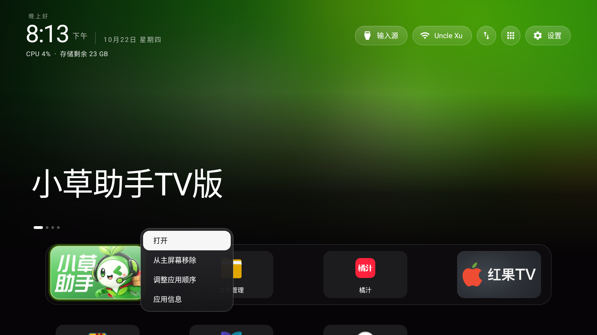
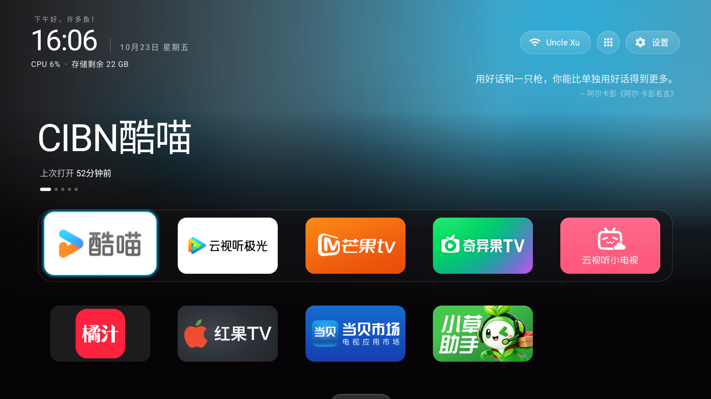
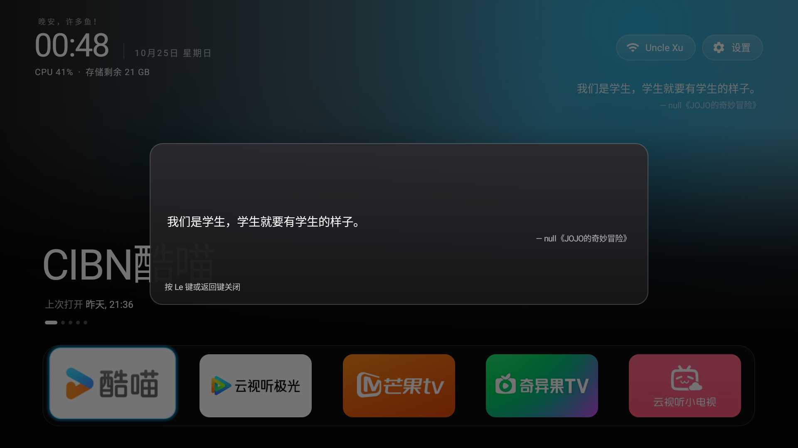
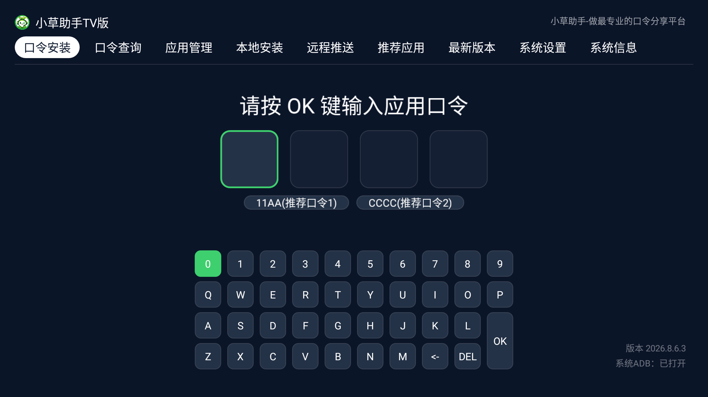

<div align="center">

# CleanLetv

**乐视电视的 CleanYourTV 深度适配版**

按键重映射 · 每日一言 · Le 键全局应用库

[](https://github.com/Gathin23/cleanyourtv)
[](./LICENSE)
[](./launcher/LICENSE)
[-ff6b35?style=flat-square)](#这是什么)

</div>

---

## 这是什么

[CleanYourTV](https://github.com/Gathin23/cleanyourtv) 是一个把 Android TV / Google TV 的广告桌面换成极简 Apple TV 风格启动器的项目，MIT 协议，214 个机型可用。

**CleanLetv 是它的乐视电视适配版。** 乐视的固件有四层机制会跟桌面打架——遥控器按键在框架层就被吃掉、桌面进程会被系统主动强杀、原厂桌面杀不掉、常驻系统窗口盖住设置面板——这些在通用版里没有解。

**实测机型：乐视 X4-65S（DemeterUHD，Android 6.0 / SDK 23，MStar 芯片，1920×1080）**

### SDK 要求已下调

上游 CleanYourTV 的 `minSdk` 是 **26**（Android 8.0），装不上乐视 X4-65S 这台 Android 6.0 的机器。本项目把下限**降到 23（Android 6.0）**：

```diff
  // launcher/app/build.gradle
- minSdk 26          // 上游 CleanYourTV
+ minSdk 23          // 本项目：为 Android 6.0 的乐视电视
```

做法是**开启 core library desugaring**——代码里的 `java.time`（`LocalDate`、`Instant`、`ZoneId`、`Duration`）只从 API 26 才存在，desugaring 把它重写成 `java.util.Calendar` / `java.text` 的等价实现，于是桌面在 API 23 上跑得起来，功能代码一行不用改。

> ⚠️ `coreLibraryDesugaringEnabled true` 和 `coreLibraryDesugaring 'com.android.tools:desugar_jdk_libs:2.0.4'` 这两行**别删**。去掉确实能省约 1.5MB 体积，但构建会因为代码里 API 26 才有的 `java.time` 调用而失败，等于回到上游那个装不上 Android 6.0 的状态。
>
> 想给 Android 8.0 以上的通用机型用，可以把 `minSdk` 改回 26 并去掉 desugaring，体积更小、依赖更少。

被下调的只有下限，`targetSdk 34` 和 `compileSdk 34` 与上游一致。**这意味着本仓库的 APK 装不了 Android 6.0 以下的电视**——上游的通用版反而能装（因为下限更高）。

---

## 三个特色

> **三个特色各自的 root 依赖**：每日一言（2️⃣）完全不需要 root；
> 按键重映射（1️⃣）必须 root——要改 `/system/usr/keylayout/*.kl`；
> Le 键全局应用库（3️⃣）必须 root——要装 `/system/bin/lekeyd` 守护进程。
> 逐项对照见 [没有 root 会怎样](#没有-root-会怎样)。

### 1️⃣ 按键重映射：让遥控器每个键都听话

> 🔒 **需要 root**：改写 `/system/usr/keylayout/*.kl` 要 root 权限。

乐视固件的 `PhoneWindowManager` 在框架层按 keycode 拦截遥控器按键，应用层和无障碍层**根本收不到**。本项目改写系统的 keylayout 文件，把这些键从固件的拦截网里"换"出来，交还给桌面。



**完整按键映射表**（红外 `Vendor_3697_Product_0001.kl` + 蓝牙 `Vendor_4c65_Product_3d4c.kl`）：

| 遥控器按键 | scancode | 原 keycode | 现 keycode | 桌面行为 |
|---|---|---|---|---|
| 设置 | 357 | 176 SETTINGS | 176 | 直接进「桌面设置」 |
| 菜单 | 139 | 82 MENU | 82 | 焦点图标弹右键菜单（打开/移除/排序/应用信息） |
| **Le 键** | 189 | 4431 LE | **135 F5** | 全局唤出应用库 / 每日一言面板 |
| **分享（截图）** | 377 | 4415 LETV | 4415（不变） | 固件自己截图，存 `/sdcard/Pictures/Screenshots/` |
| **语音** | 167 | 173 DVR | **136 F6** | 一键打开用户指定的 App |
| 输入源 | 187 | 无（VIRTUAL_NUMBER） | 无 | 乐视信号源面板（HDMI 1/2/3 + 数字电视） |

**关键点**：`KeyEvent.getScanCode()` 返回的是 **Linux EV_KEY 码**（`.kl` 文件里的 `key N`），不是 `getevent` 打印的 `MSC_SCAN` 值——后者是 USB HID 层的另一套编码，`KeyEvent` 永远不返回它。分不清这两者，按键映射必然错。

改映射用 `scripts/fixkl.sh`（幂等，重刷固件后重跑即可）：

```bash
su -c 'mount -o rw,remount /system'   # SuperSU 需要 --mount-master，见 docs/开发文档.md §9
sh fixkl.sh
reboot                                 # .kl 开机只读一次，必须重启生效
```

### 2️⃣ 每日一言：本地语句库，不联网

> ✅ **不需要 root**：语句库打包在 APK 里，装上就有。

桌面右上角每天一句，同一天固定；Le 键面板每次打开随机一句。**9896 条语句打包进 APK，完全离线**。



- 12 个分类（动画、诗词、影视、哲学、抖机灵……），**首页与 Le 键两套独立选择**
- 分类用位掩码存储，12 位全选 = 4095
- 同一天同一句：日期做种子混洗后对**命中条数**取模（不是对总数取模，否则改分类范围会偏）
- 语句库来自[一言开源社区官方语句库](https://github.com/hitokoto-osc/sentences-bundle)，随附抓取与过滤脚本

Le 键面板里可以左右方向键翻句：



### 3️⃣ Le 键：在任何 App 里唤出应用库

> 🔒 **需要 root**：要装 `/system/bin/lekeyd` 守护进程。原因见本节末尾和 [没有 root 会怎样](#没有-root-会怎样)。

乐视遥控器上那颗 **Le 键**，被固件劫持成"打开乐视视频"（`startService(com.stv.lekey)` + 启动 `com.letv.tv/.WelcomeActivity`）。本项目把它夺了回来。



- **在任何 App 里都能唤出**，且**不跳回桌面**——透明 Activity 悬浮在当前 App 之上
- 切换 App 无缝：关掉面板就回到原来那个 App
- 面板内容二选一：应用库 / 每日一言
- **关掉面板后视频自动续播**（见下）

**⚠️ 需要 root**：固件会在别的 App 到前台约 0.5 秒后 force-stop **所有**持有无障碍服务的包（连新建的单服务小包也一样），所以 App 级的全局按键监听在这台机器上**根本做不到**。本项目用 `/system/bin/lekeyd`——一个 12KB 的 root 守护进程，直接读 `/dev/input/event*`，不依赖任何 App 存活。

**顺带的"避广告"效果**：应用库面板盖上去时，下面的视频 App 会进入 `STOPPED`（不只是 PAUSED），音频轨道直接归零——**这是 App 主动触发的暂停，不会弹暂停广告**。而关闭面板后播放守卫会确认回到了同一个 App 且确实没声音，再补一个媒体播放键，**把视频还给你**。

> 判定"现在到底有没有在播"必须读 `dumpsys media.audio_flinger`——`dumpsys media_session` 的 `state=3` 在这台机器上是**陈旧的**，面板盖上去后 session 还挂着"播放中"而音频轨道早就没了。

---

## 没有 root 会怎样

乐视的固件把桌面能用的手段卡得很死，所以**这个项目的大部分功能需要 root**。下面是逐项对照——如果你的电视没有 root，装上桌面也能用，但只有一半能力。

| 功能 | 需要 root？ | 没有 root 时的情况 |
|---|---|---|
| **桌面本体**（极简 Apple TV 风格启动器） | ❌ 不需要 | ✅ **完全可用**。装 APK、开 ADB 装上就能换掉广告桌面 |
| **每日一言**（首页每天一句） | ❌ 不需要 | ✅ 完全可用，语句库在 APK 里，纯离线 |
| **应用库 / 每日一言面板**（桌面内） | ❌ 不需要 | ✅ 完全可用 |
| **天气**（和风天气） | ❌ 不需要 | ✅ 完全可用（需在桌面设置里填 API Key） |
| **无障碍服务占住设置键** | ⚠️ 半需要 | `settings put secure` 普通 shell 就能写，但 `pm install -r` 会清空无障碍设置，得手动重开 |
| **改键位映射**（设置键 / 菜单键 / Le 键 / 语音键） | ✅ **必须** | ❌ 固件的 `PhoneWindowManager` 在框架层按 keycode 吃键，桌面**收不到任何按键事件**。只能改 `/system/usr/keylayout/*.kl`，那要 root |
| **Le 键全局应用库**（在任何 App 里唤出） | ✅ **必须** | ❌ 需要 root 守护进程 `lekeyd` 直读 `/dev/input`（原因见下） |
| **关面板后视频续播** | ✅ **必须** | ❌ 依赖 root 守护进程里的 `leplay.sh` 播放守卫 |
| **修复设置键被乐视抽屉盖住** | ✅ **必须** | ❌ 要 `su -c 'pm disable com.stv.globalsetting'`，系统包不接受普通 shell 的 `pm disable` |
| **禁用原厂乐视桌面** | ✅ **必须** | ❌ 要 `su -c 'pm disable-user'`，否则桌面被强杀时按键落回乐视界面 |
| **推主题 / 改配置** | ⚠️ 半需要 | 写 `/sdcard` 不需要 root，但覆盖应用私有目录 `/data/data/com.gathin.tvhome/files/` 需要 root |

### 为什么有些功能非要 root 不可

**App 级的全局按键监听在这台机器上做不到。** 固件会在别的 App 到前台约 0.5 秒后 `force-stop` **所有**持有无障碍服务的包——连专门新建的单服务小包也一样，一样被杀。所以"装一个 App 监听 Le 键"这条路在乐视上是被堵死的，唯一的解法是一个 root 守护进程直接读 `/dev/input/event*`，不依赖任何 App 存活。

**改键位必须动 `/system`。** 固件在框架层按 keycode 拦截按键，应用层和无障碍层根本收不到事件；要让桌面能处理这些键，只能改写系统 keylayout 文件把 keycode "换"出来，而 `/system` 分区的写入权限只在 root 手里。

**有些系统组件只有 root 能动。** `pm disable` 一个系统包会被 shell 身份（uid 2000）拒绝，必须走 `su`。

### 没有 root 时的可行路线

1. 按上面的表，装好桌面后**先用能用的部分**：换掉广告桌面、每日一言、应用库面板、天气——这些都不依赖 root。
2. 如果电视能解锁 bootloader 或能用 Magisk（乐视 X4-65S 的具体可行性自行判断），root 之后回来跑 `scripts/fixkl.sh` 和部署 `lekeyd`，剩余功能就全了。
3. **提醒**：`scripts/fixkl.sh` 会改写系统分区里的 keylayout 文件，`dbg/lekeyd/` 会往 `/system/bin` 装守护进程。动手前务必完整备份（`dbg/kl-backup-orig/` 里有 `.kl` 原件备份），并先读 [docs/开发文档.md](docs/开发文档.md) 的固件机制章节。

---

## 目录结构

```
CleanLetv/
├── launcher/              桌面启动器源码（Android Studio 直接打开）
│   └── app/src/main/
│       ├── java/com/gathin/tvhome/
│       │   ├── MainActivity.java         桌面主 Activity，按键分发链在这里
│       │   ├── HomeKeyService.java        无障碍服务，占住设置键
│       │   ├── AppLibraryActivity.java    透明 Activity，全局应用库外壳
│       │   ├── AppLibraryDialog.java      应用库 / 每日一言面板
│       │   ├── Sentences.java             本地语句库索引（行偏移，不全量进内存）
│       │   ├── Hitokoto.java               取句入口（首页固定 / 面板随机）
│       │   ├── Weather.java                天气（和风天气）
│       │   ├── Lunar.java                  农历
│       │   ├── Compat.java                 高版本 API 收口（minSdk 23 的地基）
│       │   └── ...
│       └── assets/sentences.json          9896 条语句（AGPL-3.0，见 NOTICE）
├── themes/letv-x4/        乐视专属主题（按键映射、列数、程序坞…）
├── scripts/
│   ├── fixkl.sh           按键重映射（幂等）
│   └── findkl.sh          找出遥控器绑定的 .kl 文件
├── dbg/
│   ├── lekeyd/            全局 Le 键守护进程（root，纯 C）
│   │   ├── lekeyd.c       主程序
│   │   ├── lekeyd.sh      看护脚本（单实例）
│   │   ├── leplay.sh      播放守卫（关面板后把视频还回去）
│   │   └── build.sh       NDK 交叉编译
│   └── kl-backup-orig/    .kl 原件备份（用于还原）
├── tools/
│   ├── tv.py              纯 Python ADB 客户端（不依赖 adb 二进制）
│   ├── b64push.py         文件传输（这台电视的 adbd SYNC 协议会挂死）
│   ├── b64pull.py
│   └── letv-buttons.sh    一键修复设置键（禁乐视抽屉）
└── docs/
    ├── 开发文档.md         全部定制点、固件机制、坑与禁忌
    ├── 使用指引.md         面向最终用户的操作手册
    └── 迁移文档.md         装到另一台同型号电视的清单
```

---

## 快速上手

### 前置条件

**必需**：

- 一台乐视电视（Android 6.0 / SDK 23 及以上；实测机型 X4-65S）
- ADB 已开启（网络 ADB 5555 或 USB）
- 本机装了 Android SDK 与 JDK 17+

**强烈建议（没有 root 只有一半功能）**：

- **root**（SuperSU / Magisk 均可）。桌面本体、每日一言、应用库面板、天气**不需要** root；
  但**改键位映射、Le 键全局应用库、视频续播、修复设置键、禁用原厂桌面**全都需要。
  逐项对照见 [没有 root 会怎样](#没有-root-会怎样)。
- 电视已 root 时，`su` 建议用 SuperSU 且允许 ADB shell 提权；另注意 SuperSU 的
  挂载命名空间隔离（`su --mount-master`，见下方提示）。

### 1. 编译安装

```bash
cd launcher
export ANDROID_HOME=/path/to/Android/Sdk
./gradlew assembleDebug
```

> **这步不需要电视有 root**，装好 APK 就能用桌面本体、每日一言、应用库面板和天气。
>
> 编译产物：`launcher/app/build/outputs/apk/debug/app-debug.apk`。
> 因为 `minSdk` 降到了 23（见 [SDK 要求已下调](#sdk-要求已下调)），这个 APK 装得上 Android 6.0 的乐视；
> 但也意味着它只能装在 API 23 及以上——**低于 6.0 的电视装不了**。

### 2. 推送安装

```bash
# 这台固件的 adbd SYNC 协议会挂死，adb push 传不动，必须用 b64push
python tools/b64push.py launcher/app/build/outputs/apk/debug/app-debug.apk /data/local/tmp/tvhome.apk
adb shell "pm install -r -d /data/local/tmp/tvhome.apk"
```

**装完必须做这三步**（`pm install -r` 会清空无障碍设置，`am force-stop` 会连带关掉同进程的无障碍服务）：

```bash
adb shell "am force-stop com.gathin.tvhome"
adb shell "settings put secure enabled_accessibility_services com.gathin.tvhome/.HomeKeyService"
adb shell "settings put secure accessibility_enabled 1"
adb shell "input keyevent 3"    # HOME，把被屏保抢走的焦点唤回桌面
```

### 3. 部署按键重映射与守护进程（需要 root）

> 🔒 **本步需要 root。** 没有 root 就跳过——桌面本体、每日一言、应用库面板、天气不受影响，
> 只是按键映射和 Le 键全局应用库用不了。详见 [没有 root 会怎样](#没有-root-会怎样)。

```bash
adb push scripts/fixkl.sh /data/local/tmp/
adb shell "su -c 'mount -o rw,remount /system'"
adb shell "su -c 'sh /data/local/tmp/fixkl.sh'"

adb push dbg/lekeyd/lekeyd dbg/lekeyd/lekeyd.sh dbg/lekeyd/leplay.sh /data/local/tmp/
adb shell "su -c 'cp /data/local/tmp/lekeyd /system/bin/ && chmod 755 /system/bin/lekeyd'"
adb shell "su -c 'cp /data/local/tmp/lekeyd.sh /system/bin/ && cp /data/local/tmp/leplay.sh /system/bin/ && chmod 755 /system/bin/lekeyd.sh /system/bin/leplay.sh'"
adb shell "su -c 'cp /data/local/tmp/install-recovery-2.sh /system/etc/ && chmod 755 /system/etc/install-recovery-2.sh'"

adb reboot
```

> ⚠️ SuperSU 的挂载命名空间隔离：普通 `su -c` 里的 remount 只作用于该会话的私有命名空间，**返回成功但全局仍是 ro**。必须用 `su --mount-master -c "mount -o remount,rw /system; ..."`，且 cp/chmod 要写在同一个会话里。写入前先 `grep ' /system ' /proc/mounts` 确认是 `rw`，别信返回码。

### 4. 修复设置键（需要 root）

乐视的 `com.stv.globalsetting` 服务常驻一个 `TYPE_PHONE` 窗口（`ty=2008`），**永远压在 `TYPE_APPLICATION` 之上**——我们的设置面板确实启动了、焦点也是我们的，但被整层盖住。代码层面无解，只能让那扇窗消失：

```bash
TV_HOST=192.168.1.50 bash tools/letv-buttons.sh
```

> 🔒 需要 root：`pm disable` 一个系统包会被 shell 身份（uid 2000）拒绝，必须走 `su -c`。

### 5. 推主题

```bash
python tools/b64push.py themes/letv-x4/config.json /sdcard/Android/data/com.gathin.tvhome/files/config.json
adb shell "su -c 'cp -f /sdcard/Android/data/com.gathin.tvhome/files/config.json /data/data/com.gathin.tvhome/files/config.json'"
```

主题 JSON 可以改列数、程序坞行数、每日一言开关与分类、按键映射等，不用重编译。完整键表见 `themes/README.md`。

> ⚠️ 覆盖应用私有目录 `/data/data/com.gathin.tvhome/files/` 需要 root。
> 不 root 的话，主题配置得靠桌面设置界面改（列数、程序坞、每日一言分类等仍然可调）。

---

## 完整文档

| 文档 | 内容 |
|---|---|
| [docs/开发文档.md](docs/开发文档.md) | 固件机制分析、全部定制点、**26 条踩坑与禁忌**、验证方法 |
| [docs/使用指引.md](docs/使用指引.md) | 面向最终用户的操作手册 |
| [docs/迁移文档.md](docs/迁移文档.md) | 装到另一台同型号电视的完整清单 |
| [NOTICE](NOTICE) | 协议分层说明（MIT 上游 + AGPL 语句库） |

---

## 协议

本项目**整体采用 AGPL-3.0**，原因见 [NOTICE](NOTICE)：

- **桌面源码**（`launcher/`）：来自 CleanYourTV，MIT 协议，Copyright (c) 2026 Gathin。修改后同样以 MIT 发布，原授权声明保留在 `launcher/LICENSE`
- **每日一言语句库**（`assets/sentences.json`）：AGPL-3.0，打包进 APK 分发要求衍生作品同样以 AGPL-3.0 发布
- **乐视适配脚本与守护进程**：本项目作者编写，AGPL-3.0

> 如果你只想要 MIT 许可的那部分：删掉 `launcher/app/src/main/assets/sentences.json` 即可（每日一言功能失效，其余不受影响），那一份代码适用 MIT。

字体 [Outfit](https://fonts.google.com/specimen/Outfit) 采用 SIL Open Font License 1.1。

---

## 致谢

**[CleanYourTV](https://github.com/Gathin23/cleanyourtv)** — Gathin23

本项目基于它开发。这个项目让两百多种电视摆脱了广告桌面，本仓库做的是把其中一个固执的国产厂商——乐视——也拉进队伍里。

**[hitokoto-osc/sentences-bundle](https://github.com/hitokoto-osc/sentences-bundle)** — 一言开源社区

每日一言的语句库来源。

---

<div align="center">

**📋 桌面本体、每日一言、应用库面板、天气：不需要 root，装 APK 即可用。**

**⚠️ 改键位映射、Le 键全局应用库、视频续播、修复设置键、禁用原厂桌面：需要 root。**
**这些功能会修改电视的系统分区（keylayout 文件）并安装 root 守护进程。**
**请先完整备份，务必阅读 [docs/开发文档.md](docs/开发文档.md) 的固件机制章节后再动手。**

</div>
